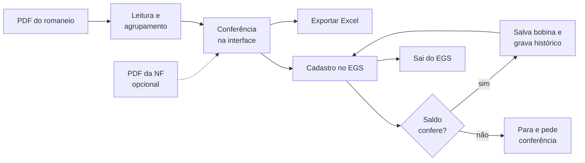

<div align="center">

# Cadastro Automático de Bobinas

**Lê romaneios em PDF, confere as bobinas e automatiza a classificação no EGS.**


[Recursos](#recursos) ·
[Como funciona](#como-funciona) ·
[Instalação](#instalação) ·
[Uso](#uso) ·
[Testes](#testes) ·
[Documentação](#documentação)

</div>

---

## Sobre

Aplicativo desktop para Windows que elimina a digitação manual de bobinas no EGS.
Ele importa o romaneio do fornecedor, mostra os dados em uma tabela para conferência,
exporta para Excel e preenche cada bobina no sistema, validando o saldo da nota a
cada salvamento.

## Recursos

| | |
| --- | --- |
| **Importação de romaneios** | Leitura de PDFs dos fornecedores ADF, HP, Novakraft e Cocelpa, com detecção automática do layout. |
| **Conferência** | Tabela com busca, filtro por grupo e resumo de quantidade e peso por produto. |
| **Conferência de NF (opcional)** | Importa a DANFE ADF e sugere a associação de cada item da nota aos grupos do romaneio. |
| **Cadastro automático** | Preenche e salva cada bobina no EGS, em segundo plano, com pausa, continuação e interrupção. |
| **Validação de saldo** | Antes de cada bobina confere se o saldo da nota comporta o peso; só registra sucesso quando o saldo diminui. |
| **Histórico local** | Evita recadastros por fornecedor e número da bobina, com filtro por romaneio. |
| **Exportação** | Gera planilha Excel com as bobinas importadas. |
| **Encerramento seguro** | Ao terminar, sai do EGS e mantém o navegador aberto para conferência. |

## Como funciona



### Fornecedores suportados

| Fornecedor | Documento |
| --- | --- |
| ADF | Romaneio |
| HP | Romaneio |
| Novakraft | Romaneio e laudo técnico |
| Cocelpa | Romaneio em duas colunas |

### Agrupamento das bobinas

Cada grupo corresponde a uma etapa da classificação no EGS e mostra seu próprio peso.

- Quando o mesmo produto tem descrições diferentes no romaneio, cada descrição forma um grupo.
- Sem variantes de descrição, **pontas** (largura abaixo de 1000) ficam separadas por
  produto e largura; larguras a partir de 1000 são agrupadas só pelo produto.
- Ajustes de peso do romaneio entram apenas no total geral.

## Instalação

### Requisitos

- Windows
- [Python 3.10 ou superior](https://www.python.org/downloads/) com Tkinter, disponível como `python`
- Acesso ao EGS (usuário, senha e chave de acesso)

### Passo a passo

1. Clone o repositório:

   ```powershell
   git clone https://github.com/Hellyton/CadastroBobinas.git
   cd CadastroBobinas
   ```

2. Crie o arquivo de configuração a partir do modelo:

   ```powershell
   copy config.example.py config.py
   ```

   Preencha as credenciais em `config.py`:

   | Campo | Descrição |
   | --- | --- |
   | `URL` | Endereço de login do EGS |
   | `USUARIO` | Usuário de acesso |
   | `SENHA` | Senha |
   | `CHAVE_ACESSO` | Chave de acesso da empresa |

   > [!IMPORTANT]
   > `config.py` fica só na sua máquina e é ignorado pelo Git. Nunca envie suas credenciais ao repositório.

3. Execute `instalar.bat`. Ele cria o ambiente virtual `venv`, instala as dependências
   e baixa o Chromium usado pela automação.

4. Abra o programa com `executar.bat`.

> [!TIP]
> Se a pasta `venv` veio de outro computador ou aponta para um Python que não existe
> mais, apague-a e rode `instalar.bat` de novo.

## Uso

1. **Importe o romaneio** (`Ctrl+O`) e confira o fornecedor detectado.
2. **Confira o Nº do romaneio.** Ele é lido do PDF quando possível e pode ser corrigido;
   é obrigatório para iniciar, pois fica gravado no histórico de cada bobina.
3. **Revise as bobinas** na tabela e o peso por grupo.
4. **(Opcional) Importe a NF** para ver as sugestões de associação por item e confirme
   em **Usar associações**.
5. Clique em **Iniciar Cadastro**. Quando a janela pedir, abra a Classificação de Bobinas
   no navegador, selecione a nota e clique em **Continuar**.
6. Em romaneios com vários grupos, escolha o próximo produto e confirme a nota no EGS
   a cada troca.
7. Ao final, o programa sai do EGS e o navegador continua aberto até você fechá-lo.

### Conferência da NF

- Cada grupo do romaneio é associado a um item da nota quando produto e peso batem
  exatamente e a correspondência é única.
- **NF com um único item:** se o peso total do romaneio for igual ao do item, a nota
  define a divisão. Todas as bobinas são cadastradas nesse item, em uma única etapa,
  e eventuais diferenças de produto aparecem como alerta.
- Se o romaneio citado na NF for diferente do carregado, as associações são bloqueadas.
- A seleção da aba e do item no EGS continua sendo feita pelo operador.

### Atalhos

| Tecla | Ação |
| --- | --- |
| `Ctrl+O` | Selecionar o PDF do romaneio |
| `Ctrl+F` | Ir para a busca |
| `Esc` (na busca) | Limpar a busca |

Filtros e buscas não alteram os totais nem a exportação.

## Proteções do cadastro

> [!WARNING]
> Se o programa avisar que um salvamento não foi confirmado, confira a bobina no EGS
> antes de tentar novamente. Ela **não** é marcada no histórico automaticamente.

- **Saldo antes de cada bobina:** saldo zerado, insuficiente ou ilegível para o lote e
  mantém as bobinas restantes pendentes.
- **Confirmação do salvamento:** o sucesso só é registrado quando o formulário fecha e o
  saldo diminui exatamente pelo peso da bobina.
- **Pausa e interrupção seguras:** aguardam a bobina em andamento terminar.
- **Histórico local:** bobinas já cadastradas são puladas. A janela **Histórico** permite
  buscar, incluir, editar e excluir registros locais (sem efeito no EGS). Registros
  antigos aparecem como **Sem romaneio** e podem ser completados em **Editar**.
- **Sessão preservada em caso de problema:** se o cadastro parar por saldo, for
  interrompido ou der erro, o programa não sai do EGS, para você conferir a tela.

## Testes

Com as dependências instaladas:

```powershell
venv\Scripts\python.exe -m unittest discover -s tests -v
```

A suíte cobre parsers, agrupamento, NF, saldo, preenchimento, controle de execução,
interface, histórico e saída do EGS. Usa navegador simulado, Chromium local sem janela
e dados sintéticos. **Não acessa o EGS** nem altera o histórico real.

<details>
<summary><strong>Teste manual com o sistema simulado</strong></summary>

<br>

Em um terminal, na pasta do projeto, suba o simulador:

```powershell
python -m http.server 8000 --bind 127.0.0.1
```

Em outro terminal, execute:

```powershell
python teste_ambiente.py
```

O teste usa `mock/mock_sistema.html` e não grava no histórico real.

</details>

## Estrutura do projeto

```text
CadastroBobinas/
├── main.py                 # Ponto de entrada
├── config.example.py       # Modelo de configuração (copiar para config.py)
├── instalar.bat            # Cria o venv e instala dependências e Chromium
├── executar.bat            # Abre o programa
├── app/
│   ├── interface.py        # Janela principal (CustomTkinter)
│   ├── leitor_pdf.py       # Detecção do fornecedor e leitura do romaneio
│   ├── parsers.py          # Layouts ADF, HP, Novakraft e Cocelpa
│   ├── agrupamento.py      # Grupos por produto, descrição e largura
│   ├── nota_fiscal.py      # Leitura da DANFE e conciliação com o romaneio
│   ├── cadastro.py         # Fluxo do cadastro em lote
│   ├── navegador.py        # Automação do EGS com Playwright
│   ├── controle.py         # Pausa, continuação e interrupção
│   ├── historico.py        # Histórico local de bobinas cadastradas
│   └── ...
├── tests/                  # Testes automatizados (unittest)
├── mock/                   # Simulador local do EGS
└── docs/                   # Documentação técnica
```

## Documentação

A pasta [`docs/`](docs/README.md) reúne a documentação técnica:

| Documento | Conteúdo |
| --- | --- |
| [Visão geral](docs/PROJECT_OVERVIEW.md) | Escopo e componentes |
| [Arquitetura](docs/ARCHITECTURE.md) | Threads, eventos e integração com o navegador |
| [Regras de negócio](docs/BUSINESS_RULES.md) | Regras RN-xx com evidência no código |
| [Funcionalidades](docs/features/README.md) | Um documento por funcionalidade |
| [Guia de desenvolvimento](docs/DEVELOPMENT_GUIDE.md) | Ambiente e testes |
| [Decisões](docs/DECISIONS.md) | Escolhas de arquitetura e motivos |
| [Histórico de mudanças](docs/CHANGELOG.md) | O que mudou e quando |

## Dados locais

Credenciais, histórico, logs, ambientes Python, PDFs e planilhas são ignorados pelo Git.
Ao levar o programa para outro computador, copie `config.py` e `historico_cadastro.json`
separadamente.
