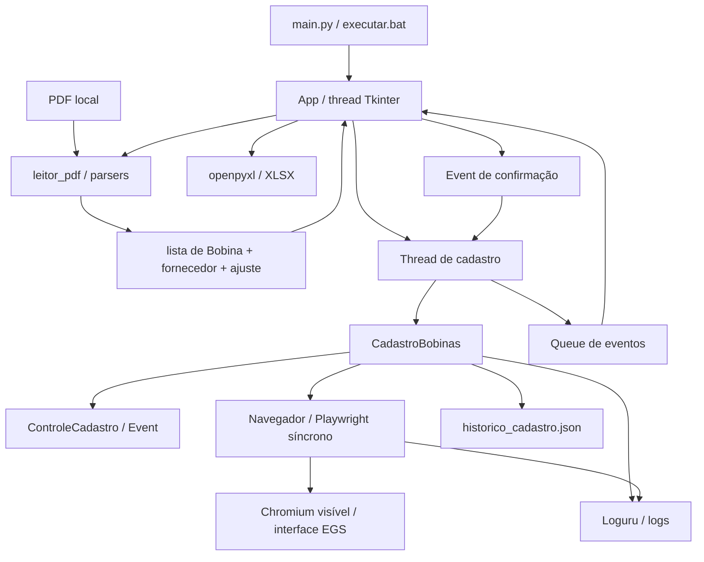

# Arquitetura

Aplicação Python desktop em módulos, sem servidor próprio. `main.py` instancia
`App` e inicia o loop Tkinter. Não foi identificado framework de injeção,
empacotamento executável, contêiner ou serviço de banco de dados.

## Responsabilidades

| Componente | Responsabilidade | Dependências internas |
| --- | --- | --- |
| `interface.App` | Diálogos, tabela, resumo, exportação, thread e eventos | leitor, cadastro, controle, logger |
| `leitor_pdf.ler_romaneio` | Detectar/selecionar parser e retornar tripla | parsers |
| `parsers` | Transformar texto/coordenadas do PDF em bobinas e ajuste | modelos |
| `modelos.Bobina` | Dados transitórios do cadastro | dataclasses |
| `cadastro.CadastroBobinas` | Histórico, grupos, saldo, cadastro e resultados | navegador, controle, historico, logger, config |
| `navegador.Navegador` | Login, leitura de tela, preenchimento e confirmação | Playwright, config, logger |
| `controle.ControleCadastro` | Pausa e interrupção cooperativas | threading.Event |
| `historico` | Deduplicação entre execuções e arquivo JSON | json, os |
| `logger` | Destino de log com rotação | Loguru |

Símbolos e caminhos: [FILE_MAP](FILE_MAP.md). Bibliotecas e contratos externos:
[API_INTEGRATIONS](API_INTEGRATIONS.md).

## Fluxo de dados e concorrência

`ler_romaneio` retorna `(bobinas, fornecedor_usado, ajuste_peso)`. A interface
atribui `fornecedor` a cada objeto e mantém a lista em memória. A extração roda
na thread Tkinter; o cadastro roda em `Thread(daemon=False)` com cópia da lista.
Essa cópia é superficial; os controles de seleção/reprocessamento são desativados
durante a execução. A exportação permanece disponível.

O navegador é criado, operado e fechado na thread de cadastro. `evento` publica
`status`, `progresso`, `confirmacao`, `finalizado` e `erro` numa `Queue`;
`App.processar_eventos` a consulta a cada 100 ms. Apenas a thread principal altera
widgets. Confirmações usam um dicionário com mensagem, opções, resposta e `Event`.
A thread espera em intervalos de 100 ms e verifica o controle cooperativo.

`ControleCadastro.verificar` bloqueia enquanto pausado ou lança
`CadastroInterrompido`. Não há cancelamento imediato de uma chamada Playwright.
O fechamento da janela solicita interrupção e aguarda a thread terminar.

## Persistência e consistência

Após o EGS confirmar fechamento do formulário e saldo esperado, grava-se o
histórico e então contabiliza-se sucesso. JSON e EGS não participam de uma
transação conjunta. Não existe reconciliação automática após incerteza de
salvamento ou falha de disco. Detalhes: [DATABASE](DATABASE.md) e problemas
[KI-01 a KI-03](KNOWN_ISSUES.md#ki-01--historico-nao-transacional).

## Autenticação e segurança observáveis

`config.py` fornece usuário, senha e chave de acesso ao formulário de login;
a sessão é a do navegador criado por Playwright. Não há autorização local,
gerenciamento próprio de sessão, cofre ou criptografia de configuração identificados.
As permissões efetivas são as concedidas pela conta no EGS, não mapeadas no código.
Segredos e arquivos operacionais são ignorados pelo Git. Logs podem registrar
dados de bobinas e erros e precisam ser tratados como dados operacionais.

`Navegador.abrir` fixa `headless=False`. `HEADLESS`, `TIMEOUT` e `RUA_PADRAO`
do exemplo não são aplicados pelo fluxo; não confundir configuração declarada
com comportamento efetivo. [Decisões](DECISIONS.md) separam razões verificadas
de escolhas cujo motivo não foi identificado.
